# LocalTV Remote

Control a Windows PC from your phone. Use the phone screen as a mouse, keyboard, and volume control.

Install LocalTV Remote on the PC. Open the controller in your phone browser. No phone app or account is required.

[Download for Windows](https://github.com/creationsofm7/localtv-remote/releases/latest) · [User guides](https://creationsofm7.github.io/localtv-remote/) · [Report a problem](https://github.com/creationsofm7/localtv-remote/issues) · [Apache 2.0 license](LICENSE)

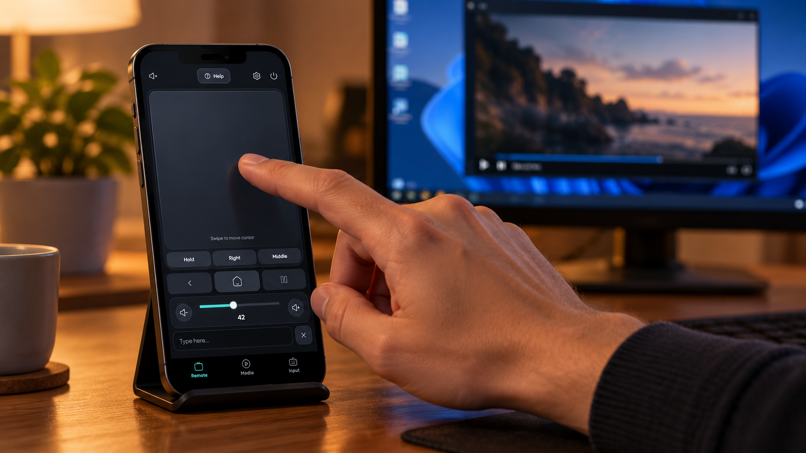

*Illustrative product photo generated with AI. The controller screenshots below show the running application.*

## See the controls

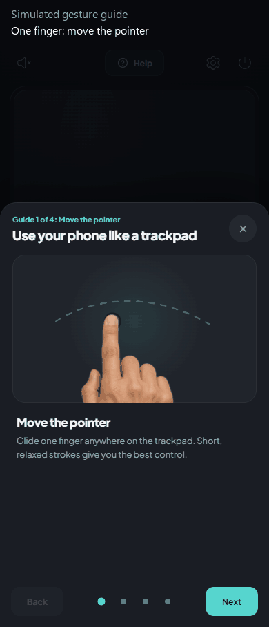

*Simulated gesture demonstration recorded from the local controller. The hands are AI-generated. This is not a recording of PC input.*

<table>
  <tr><th>Remote</th><th>Media</th><th>Keyboard</th></tr>
  <tr>
    <td>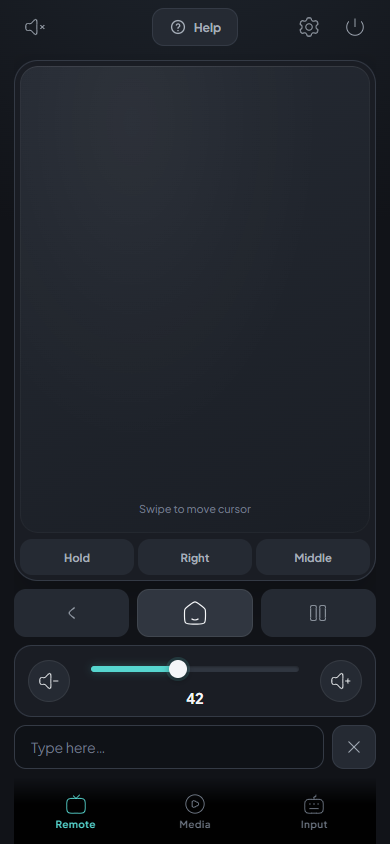</td>
    <td>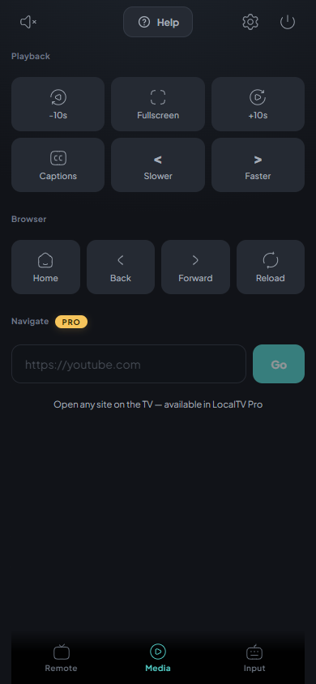</td>
    <td>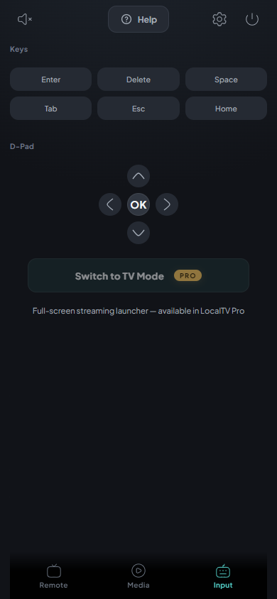</td>
  </tr>
</table>

| Control | Function |
| --- | --- |
| Trackpad | Move the pointer. Click, drag, and scroll. |
| Text field | Send text to the active PC application. |
| Keyboard panel | Send navigation keys, Enter, Space, Tab, Esc, and Backspace. |
| Media panel | Send playback and browser shortcuts. |
| Volume slider | Change the Windows volume. |
| Mute button | Turn mute on or off. |
| Settings | Change pointer speed, cursor visibility, and the power action. |
| Power button | Request Sleep or Shutdown after confirmation. |

Several phones can control the same PC. Each phone must pair with the PC. Their commands affect the same desktop.

LocalTV Remote does not stream the PC screen. It does not include TV playback, DRM, or a bundled Chromium browser.

## Requirements

- A Windows 10 or Windows 11 PC. The installer requires Windows 10 build 17134 or later.
- A phone with a current browser and touch input.
- A local network that lets the phone connect to the PC.

Use a trusted local network. The control connection uses unencrypted HTTP and WebSocket traffic.

## Install on the PC

1. Open the [latest release](https://github.com/creationsofm7/localtv-remote/releases/latest).
2. Download the `LocalTVRemote-Setup-*.exe` installer.
3. Run the installer.
4. Select the installation options.
5. Start **LocalTV Remote** from the Start menu.

The installer offers a desktop shortcut and start-on-login option. It also attempts to add a Windows Firewall rule.
Firewall permissions depend on the installation mode and Windows settings.

Windows Package Manager is an alternative:

```powershell
winget install --id LocalTV.Remote --exact
```

If the package is unavailable, use the release installer.

## Connect your phone

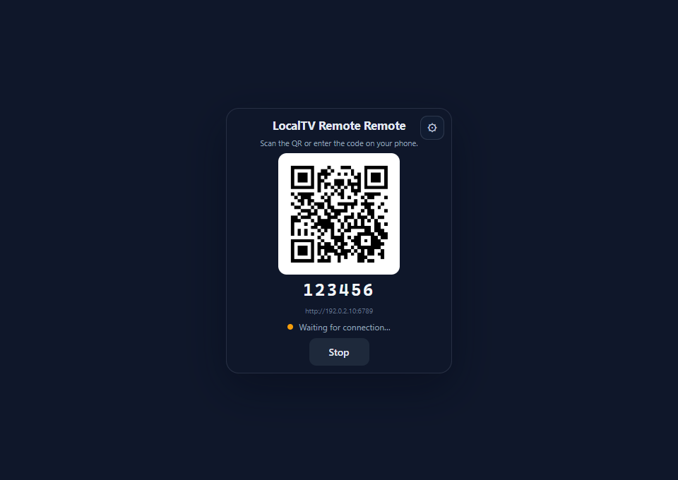

*Demonstration code and address. Use the values shown on your PC.*

1. Connect the phone and PC to the same local network.
2. Start LocalTV Remote on the PC.
3. Open the PC pairing window.
4. Scan its QR code with the phone camera.
5. Open the controller link.

The QR link includes the pairing code. The controller connects automatically when the code is accepted.

If you cannot scan the QR code:

1. Enter the controller address in the phone browser.
2. Enter the six-digit code shown on the PC.
3. Tap **Connect**.

<table>
  <tr><th>Enter the code</th><th>Use the remote</th><th>Adjust settings</th></tr>
  <tr>
    <td>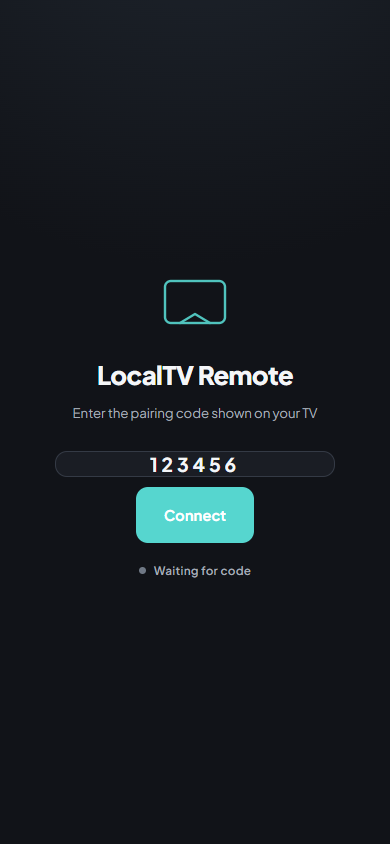</td>
    <td></td>
    <td>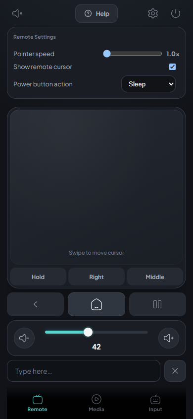</td>
  </tr>
</table>

The browser saves a session token and the last pairing code. Later connections can use these saved values.
Clear the browser site data to remove them from that phone.

## Use the trackpad

The **trackpad** is the large area above the **Hold**, **Right**, **Middle**, and **Capture** buttons.
Keep touch gestures inside this area.

<table>
  <tr><th>Move the pointer</th><th>Click and drag</th><th>Right-click and scroll</th></tr>
  <tr>
    <td>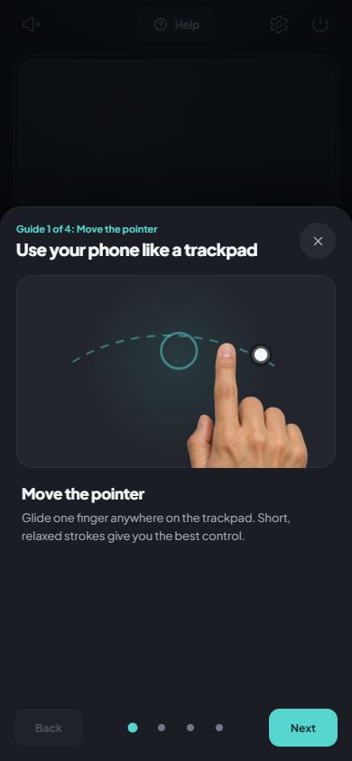</td>
    <td>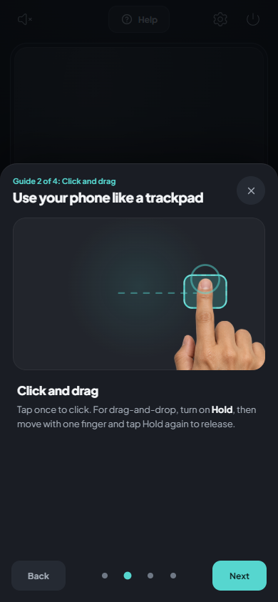</td>
    <td>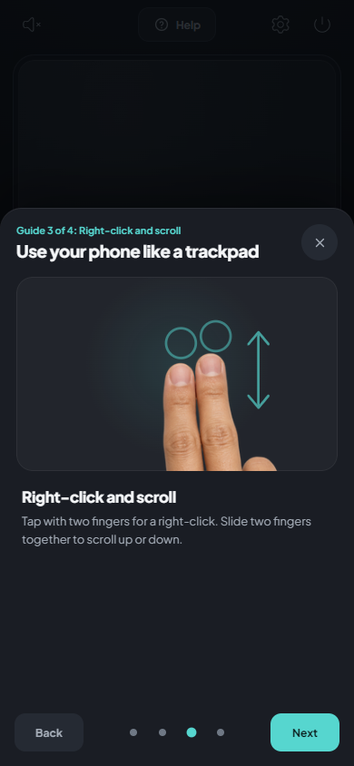</td>
  </tr>
</table>

### Move and click

1. Slide one finger on the trackpad to move the PC pointer.
2. Lift your finger to stop movement.
3. Tap once with one finger to click.

For a double-click, tap twice in quick succession. The result depends on the PC double-click settings.

### Drag an item

1. Move the pointer onto the item.
2. Tap **Hold** to keep the left mouse button pressed.
3. Slide one finger to move the item.
4. Tap **Hold** again to release the item.

**Hold** is a toggle. A long press on the trackpad does not start this drag mode.

### Right-click and scroll

- Tap the trackpad with two fingers to right-click.
- Slide two fingers up or down together to scroll.
- Tap **Right** for a separate right-click button.
- Tap **Middle** for a middle click.

Pinch zoom and three-finger gestures are not supported.

Tap **Help** to open these guides. Swipe between the cards, or use **Back** and **Next**.

## Enter text and use media controls

1. Select the destination text field on the PC.
2. Tap **Type here…** on the phone.
3. Enter the text.

Text goes to the active PC application. Open the **Input** tab for additional keyboard keys.
The button labeled **Delete** sends Backspace.

Use the **Media** panel for playback and browser controls. These buttons send keyboard commands to the active application.

| Button | Command |
| --- | --- |
| Play / Pause | Windows media play/pause key |
| -10s / +10s | `J` / `L` |
| Fullscreen | `F` |
| Captions | `C` |
| Speed down / up | `Shift+,` / `Shift+.` |
| Browser navigation | Windows browser navigation keys |

The application must support the command. The URL navigation field is disabled in this remote edition.

## Add a Home Screen shortcut

<table>
  <tr><th>iPhone</th><th>Android</th></tr>
  <tr>
    <td>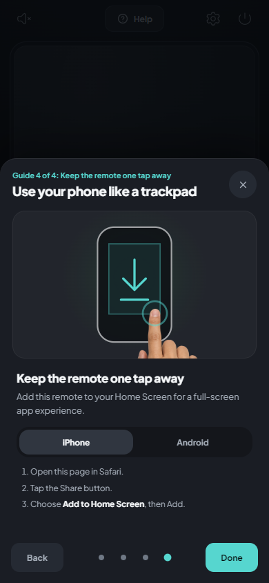</td>
    <td>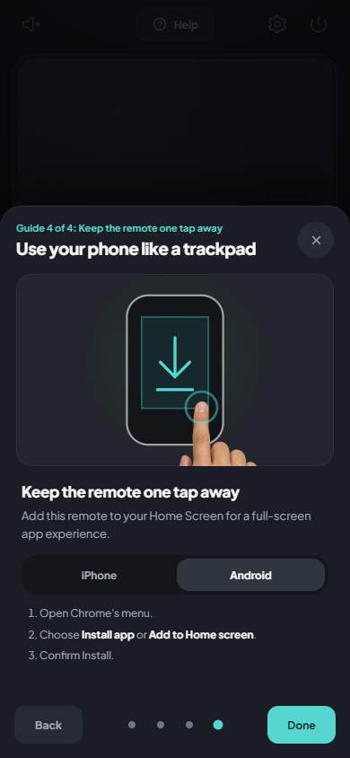</td>
  </tr>
</table>

On iPhone:

1. Open the controller in Safari.
2. Open the browser Share menu.
3. Select **Add to Home Screen**.
4. Tap **Add**.

On Android:

1. Open the controller in Chrome.
2. Open the browser menu.
3. Select **Add to Home screen** or **Install app**, if available.
4. Complete the browser instructions.

The available options depend on the browser. The controller uses a local HTTP address.
Some browsers do not permit full PWA installation at this address. You can continue to use the browser page.

## Troubleshooting

| Problem | Action |
| --- | --- |
| The phone cannot open the controller. | Check the network connection. Use the address shown on the PC. |
| Guest Wi-Fi blocks the connection. | Use a network without client isolation. |
| The wrong network address is shown. | Select the correct adapter in the PC pairing window. |
| Windows Firewall blocks the connection. | Allow LocalTV Remote on the trusted network profile. |
| The pairing code is rejected. | Enter the current code shown on the PC. |
| The controller opens but input has no effect. | Select a PC application. Check whether it runs with elevated permissions. |
| A media button has no effect. | Check whether the application supports that shortcut. |
| The pointer moves too fast. | Open **Settings** and reduce **Pointer speed**. |
| An item remains attached to the pointer. | Tap **Hold** again to release it. |
| The pairing window does not open. | Check the default browser. The app can use it if WebView2 fails. |

See the [user guides](https://creationsofm7.github.io/localtv-remote/) for detailed connection, input, and firewall procedures.

## Network and security

LocalTV Remote is intended for a trusted local network. It requires no cloud relay or account.
The server listens on all IPv4 interfaces. The default control port is `6776`.
If that port is occupied, the app searches for another port.

- Pairing requires a six-digit code. The QR link contains that code.
- The code is derived from the PC name and Windows user name. It is not a temporary one-time code.
- `/host`, `/api/state`, `/api/network`, and `/api/quit` accept local loopback connections only.
- Each paired phone can send PC input, volume commands, and power requests.
- The server limits message rates and closes inactive connections.

HTTP and WebSocket traffic are not encrypted. Do not forward the control port to the internet.
Keep the pairing code and QR link private.

The controller requests a font from Google Fonts. It can make an external request when the page opens.

See [SECURITY.md](SECURITY.md) to report a security issue.

## How it works

```text
Phone browser
    |
    | HTTP + WebSocket
    v
LocalTV Remote on Windows
    |-- Mouse and keyboard: Win32 SendInput through koffi
    |-- Volume: Windows Core Audio through PowerShell
    |-- Pairing window: system WebView2, or the default browser
    `-- Tray menu and start-on-login settings
```

The app sends input to the Windows desktop. Elevated applications and some games can reject injected input.
The phone does not receive a screen stream.

## Build from source

Use Windows and Node.js 22 or later.

```powershell
git clone https://github.com/creationsofm7/localtv-remote.git
cd localtv-remote
npm install
npm run dev
```

Check the source and run the tests:

```powershell
npm run typecheck
npm test
```

Create the Windows executable and installer:

```powershell
npm run dist
npm run installer
```

The executable build requires Windows x64 Node.js. The installer build uses Inno Setup.
The installer is written to `release/`.

| Environment variable | Default | Function |
| --- | --- | --- |
| `LOCALTV_REMOTE_PORT` | `6776` | Set the preferred control port. |
| `LOCALTV_REMOTE_STATIC_DIR` | `public/control` | Set the controller asset directory. |

### Source layout

```text
src/daemon/                Entry point, tray, pairing page, and startup settings
src/core/main/control/     HTTP server, WebSocket server, and network selection
src/core/main/input/       Input parser, router, shortcuts, and backend interface
src/core/main/native/      Windows input bindings
src/core/main/audio/       Windows volume control
src/core/shared/           Protocol types
public/control/           Phone controller and Help guides
scripts/                  Build and documentation capture tools
installer/                Inno Setup definition
tests/                    Automated tests
docs/                     User guides and README media
```

Windows is the supported PC platform. A new platform requires an implementation of `SystemInputBackend`.

## Contribute

1. Read [CONTRIBUTING.md](CONTRIBUTING.md).
2. Create a branch for the change.
3. Make the change.
4. Run the relevant checks.
5. Open a pull request.

See the [media guide](docs/media/README.md) for asset sources, capture instructions, and the publishing strategy.

## License

Apache 2.0. See [LICENSE](LICENSE).

Copyright 2026 Mudit Pandey.
